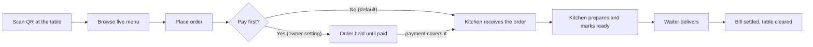
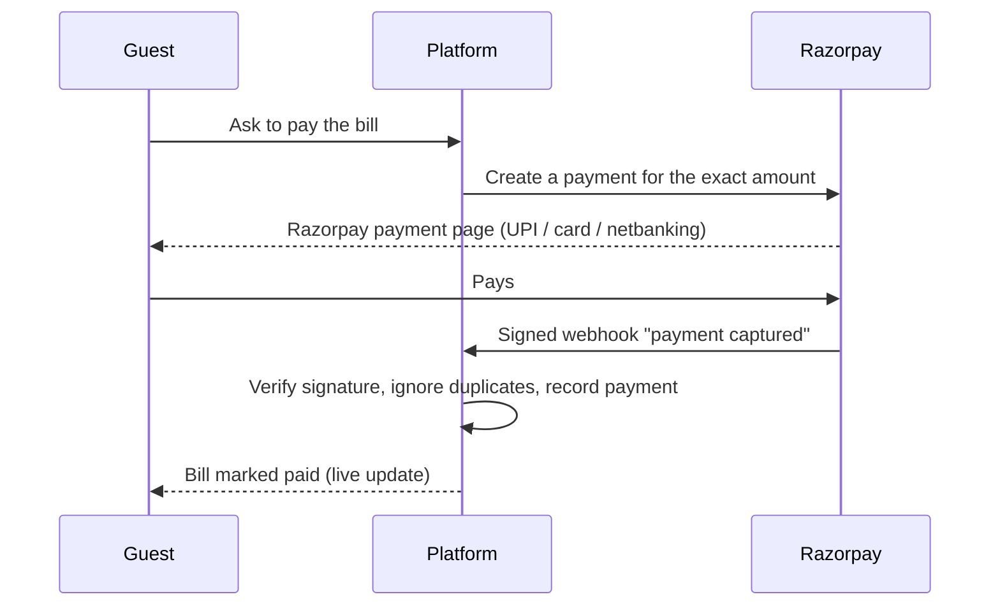
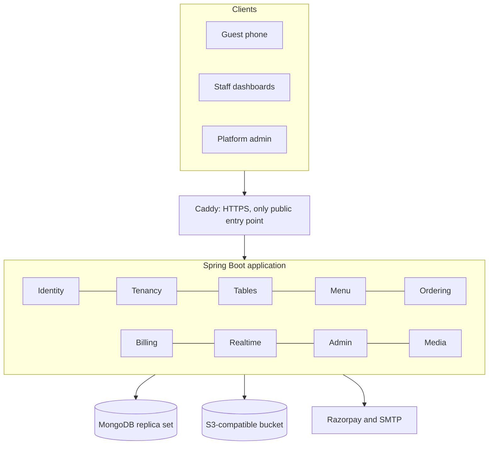

# Universal Restaurant QR Ordering Platform

A multi-tenant restaurant ordering system. A guest scans a QR code at the table, browses the live menu, orders and pays
from their phone. The kitchen, waiters, cashier and owner each work from live screens. Many restaurants share one
platform, and each one's data stays strictly isolated.

> **Status:** the backend (Phases 1 to 14) is built and tested. The React frontends are planned next.
> Until they exist, the platform is exercised through its REST and WebSocket APIs.

---

## Table of contents

1. [The problem and the idea](#the-problem-and-the-idea)
2. [Features](#features)
3. [How it works](#how-it-works)
4. [Architecture](#architecture)
5. [Tech stack](#tech-stack)
6. [Project structure](#project-structure)
7. [Roles and permissions](#roles-and-permissions)
8. [API overview](#api-overview)
9. [Getting started (development)](#getting-started-development)
10. [Configuration](#configuration)
11. [Testing](#testing)
12. [Security](#security)
13. [Payments and where the money goes](#payments-and-where-the-money-goes)
14. [Production deployment](#production-deployment)
15. [Operations: backups, monitoring, images](#operations-backups-monitoring-images)
16. [Design decisions](#design-decisions)
17. [Roadmap](#roadmap)
18. [Documentation](#documentation)
19. [Author and license](#author-and-license)

---

## The problem and the idea

Ordering in a restaurant is slow and error-prone: guests wait to be noticed, orders are written by hand and carried to the
kitchen, bills are added up manually, and owners have little visibility into what was ordered, cooked and paid. A platform
that serves many restaurants must also keep every restaurant's menu, staff, orders and money apart, and keep working
when many guests, staff and payment notifications arrive at once.

**The idea:** put the whole table-side process on the guest's phone and on staff screens, backed by one always up-to-date
record, with every restaurant isolated as its own tenant. No app to install, no waiting for the bill, no hand-copied orders.

## Features

- **QR ordering without an app or login.** Each table has its own QR code. Scanning opens that table's live menu.
- **Multi-tenant by design.** Every restaurant ("hotel" in the code) has its own staff, tables, menu, orders and payments.
- **Roles and permissions.** Owner, manager, kitchen, waiter and cashier, with owner-adjustable permissions.
- **Kitchen and service flow.** Orders move through the kitchen in a fixed order, with every change recorded. Waiters
  deliver, answer table requests and clear tables.
- **Server-side billing.** Totals are computed on the server in integer paise from real menu prices, never from the client.
- **Payments.** Cash recorded by the cashier, and online payments through Razorpay with signed webhooks, duplicate
  protection and a reconciliation report.
- **Pay before food (optional).** Orders can be held until paid; held orders release in order as payments arrive and expire if unpaid.
- **Real-time updates.** WebSocket (STOMP) updates for kitchen, waiters, cashier and the guest's own orders.
- **Menu with images.** Categories, items, variants, add-ons, availability. Images upload straight to an S3-compatible
  bucket with short-lived signed URLs and are verified before use.
- **Platform administration.** Hotel directory, suspend / reactivate / deactivate with an audit log, platform statistics and health.
- **Hardened and tested.** Rate limiting, security headers, strict CORS, log redaction, dependency scanning, a cross-tenant
  sweep, a concurrency suite and an architecture test.
- **Operable.** Docker image, production compose stack with automatic HTTPS, explicit index creation, backups with a restore test,
  health checks, metrics and an optional Prometheus and Grafana stack.

## How it works

### The guest journey



1. **Scan.** The QR code carries a secret token for one table. The server checks it, finds or opens the table's single
   dining session, and gives the phone a secure cookie. The cookie identifies the guest afterwards. There is no login.
2. **Browse.** The public menu is served from the restaurant's own data, including what is currently available.
3. **Order.** The phone sends item ids and quantities only. The server prices and records the order. A unique request key
   makes a double tap harmless.
4. **Kitchen and service.** Staff see the order in real time and move it through its stages. Each change records who did it and when.
5. **Pay and close.** The bill adds up all orders for the table. When paid, the table is cleared and the session closes.

### Confirming an online payment



The platform trusts only the signed webhook, never the browser's word that a payment worked.

## Architecture

The backend is a **modular monolith**: one deployable application split into feature modules with enforced dependency
rules (checked by an architecture test).



**Tenant isolation.** Every restaurant route carries the restaurant's id. A resolver checks in the database that the caller is
an active member with the right role, and answers "not found" otherwise, so another restaurant's ids cannot be probed.
The same rule applies to objects (orders, tables, payments, images).

## Tech stack

| Area | Technology |
|---|---|
| Language and framework | Java 21, Spring Boot (web, security, validation, actuator) |
| Database | MongoDB 7 as a replica set (multi-document transactions) |
| Authentication | JWT access tokens (15 minutes) plus a refresh token in a secure cookie |
| Real time | STOMP over WebSocket |
| Payments | Razorpay (orders and signed webhooks) |
| Images | S3-compatible storage (AWS S3, Cloudflare R2, MinIO) with pre-signed uploads |
| QR codes | ZXing |
| Packaging | Docker, Docker Compose, Caddy (automatic HTTPS) |
| Observability | Spring Boot Actuator, Micrometer and Prometheus, optional Grafana |
| Tests | JUnit 5, Testcontainers (real MongoDB), ArchUnit, MockMvc |
| Frontend (planned) | React with Vite and TypeScript |

## Project structure

```
backend/                       Spring Boot app, package com.example.qrorder
  common/                      errors, security, rate limiting, log redaction, metrics, config (no business imports)
  identity/                    accounts, login, email verification, password reset
  tenancy/                     hotels, staff, invitations, roles, permissions, tenant resolution
  tables/ dining/              tables, QR credentials, dining sessions, waiter requests
  menu/ media/                 menu and item images (pre-signed uploads)
  ordering/ billing/           orders and kitchen flow, bills, payments, reconciliation
  realtime/ admin/             WebSocket, platform admin APIs
docs/                          concurrency matrix, operations guide, deployment guide
ops/                           backup, restore test, backup freshness check, monitoring configuration
docker-compose.yml             development: Mongo replica set and Mailpit (dev mail inbox)
docker-compose.prod.yml        production: Mongo, app, Caddy; optional Prometheus and Grafana (profile "monitoring")
Caddyfile                      reverse proxy and HTTPS
.env.example                   every environment variable, with blank values
```

## Roles and permissions

| Role | Typical responsibilities |
|---|---|
| Guest | Scans the QR, browses, orders, calls the waiter, pays. No account. |
| Owner | Creates the restaurant, invites staff, manages tables, QR codes, menu and payment settings. |
| Manager | Day-to-day operations: menu, availability, tables, adjustments. |
| Kitchen | Sees the live order queue; accepts, prepares and marks orders ready. |
| Waiter | Delivers ready orders, answers table requests, clears tables. |
| Cashier | Records cash payments, applies discounts, tracks unpaid bills. |
| Platform admin | Works for the platform: hotel directory, suspend / reactivate, audit log, statistics, health. |

Code checks **permissions** (for example `MANAGE_MENU`, `TAKE_PAYMENT`, `CLEAR_TABLE`); roles map to permissions and the owner
can adjust the mapping.

## API overview

All endpoints are under `/api/v1`. Interactive documentation (Swagger UI) is available in the `dev` profile only.

| Area | Examples |
|---|---|
| Auth | `POST /auth/register`, `/auth/login`, `/auth/refresh`, `/auth/logout`, `/auth/verify-email`, `/auth/forgot-password`, `GET /auth/me` |
| Hotels | `POST /hotels`, `GET /hotels`, `GET /hotels/{hotelId}`, staff and invitations under `/hotels/{hotelId}/...` |
| Menu | `/hotels/{hotelId}/menu/items`, `/menu/categories`, `PUT /menu/items/{itemId}/image` |
| Images | `POST /hotels/{hotelId}/media/uploads`, `POST /hotels/{hotelId}/media/{assetId}/complete` |
| Guest | `POST /scan`, `GET /public/hotels/{id}/menu`, `/customer/orders` |
| Billing | `POST /hotels/{hotelId}/sessions/{sessionId}/payments` (cash and online) |
| Platform admin | `/admin/hotels` (+ `/suspend`, `/reactivate`, `/deactivate`), `/admin/stats`, `/admin/audit`, `/admin/health` |
| Operations | `/actuator/health/readiness` and `/liveness` (public); `/actuator/prometheus` (internal network only) |

Errors use RFC 7807 `application/problem+json` with a stable `code`, and every response carries an `X-Trace-Id` header
to correlate it with the logs.

## Getting started (development)

### Prerequisites

- JDK 21 and Maven 3.9+
- Docker (Mongo for development, and Testcontainers for tests)

### Run

```bash
docker compose up -d                      # Mongo replica set and Mailpit (mail inbox UI: http://localhost:8025)
cd backend
SPRING_PROFILES_ACTIVE=dev mvn spring-boot:run
```

- Health: <http://localhost:8080/actuator/health>
- Swagger UI (dev only): <http://localhost:8080/swagger-ui.html>
- Verification and reset emails appear in Mailpit.

### Try it

```bash
# 1. Register, then open the verification link in Mailpit
curl -X POST localhost:8080/api/v1/auth/register -H "Content-Type: application/json" \
  -d '{"email":"owner@example.com","password":"a-long-password-123","name":"Owner"}'

# 2. Log in and keep the accessToken
curl -X POST localhost:8080/api/v1/auth/login -H "Content-Type: application/json" \
  -d '{"email":"owner@example.com","password":"a-long-password-123"}'

# 3. Create a restaurant
curl -X POST localhost:8080/api/v1/hotels -H "Authorization: Bearer <accessToken>" -H "Content-Type: application/json" \
  -d '{"name":"Spice Garden","address":"Bengaluru","timezone":"Asia/Kolkata"}'
```

To get a ready-made platform admin, set `APP_ADMIN_EMAIL` and `APP_ADMIN_PASSWORD` before the first start.

## Configuration

Everything is configured with environment variables; see [`.env.example`](.env.example). Highlights:

| Variable | Purpose |
|---|---|
| `DOMAIN` | Public host name Caddy gets a certificate for |
| `MONGODB_URI` | Database connection (set by the production compose file) |
| `APP_CORS_ALLOWED_ORIGINS` | Exact `https` frontend origins allowed to call the API |
| `APP_FRONTEND_BASE_URL` | Base address used in emailed links and QR codes |
| `APP_JWT_SECRET` | JWT signing secret, at least 32 random characters |
| `APP_ADMIN_EMAIL`, `APP_ADMIN_PASSWORD` | First platform admin (created at startup if absent) |
| `APP_FROM_EMAIL`, `SPRING_MAIL_*` | Outgoing email |
| `APP_MEDIA_*` | Image storage: `BUCKET`, `ENDPOINT`, `REGION`, `ACCESSKEY`, `SECRETKEY`, `PUBLICBASEURL` (leave `BUCKET` empty to disable) |

Rule for names: replace dots with underscores, remove dashes and use upper case (`app.jwt.secret` becomes `APP_JWT_SECRET`).

The `prod` profile **refuses to start** on unsafe settings: an insecure cookie, a non-HTTPS or localhost CORS origin, a weak
JWT secret, or a MongoDB URI that is not a replica set.

## Testing

```bash
cd backend
mvn test           # unit and architecture tests
mvn verify         # also integration tests (needs Docker for Testcontainers)
```

| Suite | What it proves |
|---|---|
| Feature tests | Each API works for the right roles and refuses the wrong ones |
| `CrossTenantSweepIT` | Every route, found automatically, refuses access from another restaurant |
| `ConcurrencyCasesIT`, `OnlinePaymentIT` | Races (payments, releases, cancellations, expiry, duplicate webhooks) end in consistent states |
| `ArchitectureTest` | Modules only depend on the modules they are allowed to |
| Security tests | Headers, CORS, rate limits, log redaction |
| `IndexInitializerIT` | Required indexes (such as one open session per table) exist |

Opt-in suites:

```bash
mvn verify -Dload.test=true -Dload.guests=200                 # load smoke test (report in target/load-report.txt)
mvn -Psecurity-scan verify                                    # dependency vulnerability scan (needs NVD_API_KEY)
mvn verify -Ds3.test.image=<minio-compatible-image>           # signed uploads against a real S3-compatible server
```

Run the load test on a quiet machine: a busy laptop distorts the timings.

## Security

- Deny-by-default endpoints; tenant and role checks on every hotel route; "not found" for anything outside the caller's tenant
- Passwords stored as one-way hashes; short-lived access tokens; refresh cookie with `SameSite=Strict`
- Rate limits on login, scanning and ordering
- Security headers (HSTS, CSP, `nosniff`, frame denial, referrer and permissions policies) and an exact-origin CORS allowlist
- Secrets, tokens and emails are masked in logs
- Signed webhooks only for payment confirmation; duplicates are ignored
- Uploaded images are limited to JPEG, PNG and WebP and verified by their first bytes (no SVG)
- Platform admin actions need a reason, are audited and re-check the admin's rights in the database
- Dependabot and an optional OWASP dependency scan

## Payments and where the money goes

- **Cash:** the cashier records it against the table's bill. No money passes through the platform.
- **Online (Razorpay):** the guest pays on Razorpay's own page; card and UPI details never reach this system.
- **Settlement:** Razorpay pays out to the bank account of whoever owns the API keys, usually a few business days later.
  With a single platform account, that would be the platform's account. The chosen direction is that **each restaurant owner
  connects their own Razorpay account**, so money goes straight to them and the platform never holds it.
  This per-restaurant key step is planned and **not built yet**.

Use Razorpay **test keys** (`rzp_test_...`) until the whole flow works end to end, and keep test and live key, secret and
webhook secret together as a set. Webhooks need a public HTTPS address.

## Production deployment

```bash
cp .env.example .env                       # fill in every value
docker compose -f docker-compose.prod.yml up -d --build
curl -i https://<your-domain>/actuator/health/readiness
```

The stack runs MongoDB (a single-node replica set, not published to the host), the app (non-root image, graceful shutdown)
and Caddy (automatic HTTPS, the only public entry point on ports 80 and 443). Full steps, updates and rollback are in
[`docs/deployment.md`](docs/deployment.md).

Before real customers: add authentication to MongoDB (or use a managed database), configure SMTP and the payment accounts,
set up off-server backups, and rehearse a restore.

## Operations: backups, monitoring, images

- **Backups:** `bash ops/backup.sh` takes a consistent compressed snapshot with rotation; `bash ops/check-backup.sh` fails if the
  newest one is missing, tiny or old; `bash ops/restore-test.sh <file>` proves a backup restores. Schedule them with cron.
- **Indexes:** created explicitly at startup in production and logged; conflicts stop the start-up with a clear message.
- **Monitoring:** readiness includes the database; metrics at `/actuator/prometheus` are reachable only on the internal network
  (Caddy returns 404 for them). Start the optional stack with
  `docker compose -f docker-compose.prod.yml --profile monitoring up -d` (Prometheus and Grafana, bound to the server's loopback).
  Pair it with a free external uptime monitor on the readiness URL.
- **Logs:** plain text with a trace id, rotated by Docker (5 files of 10 MB per container).
- **Images:** browsers upload directly to the bucket using a signed URL; the server then confirms the file is a real image.
  The bucket needs CORS for your frontend origin, and images should be served from a separate public domain or CDN.

Details are in [`docs/operations.md`](docs/operations.md).

## Design decisions

| Decision | Reason |
|---|---|
| Modular monolith | One thing to run and debug, with module boundaries enforced so it can be split later |
| MongoDB replica set | Multi-document transactions for bills, payments and held orders |
| Money in integer paise | No floating-point rounding errors |
| Pre-signed uploads | Image bytes never pass through the API server |
| Webhook-only payment confirmation | The browser cannot be trusted to say a payment succeeded |
| "Not found" for foreign ids | Prevents probing which ids exist in other restaurants |
| Unique indexes for invariants | The database, not just the code, guarantees one open session per table |
| Tests that race on purpose | Concurrency bugs only show up under overlap |

## Roadmap

- [x] Backend phases 1 to 14: accounts and tenants, staff and roles, tables and QR, menu, orders and kitchen, waiters,
      billing and payments, real time, platform admin, hardening, Docker, backups, image storage, monitoring, docs
- [ ] Per-restaurant Razorpay keys with encrypted storage (step 14.5)
- [ ] React frontends: monorepo and shared UI kit, staff login, owner screens, menu management, guest ordering and live tracking,
      kitchen, waiter, manager and cashier dashboards, platform admin app, accessibility and end-to-end tests
- [ ] Optional: MongoDB access control or managed database, alert delivery (Alertmanager), image resizing, structured JSON logs

## Documentation

- [`docs/deployment.md`](docs/deployment.md): from a blank server to a running system, updates and rollback
- [`docs/operations.md`](docs/operations.md): indexes, backups and restore, image storage, database access control
- [`docs/concurrency-matrix.md`](docs/concurrency-matrix.md): the twelve concurrency cases and the tests that cover them
- Design document: `restaurant-qr-platform-design.md`

## Author and license

Built by Bharath ([github.com/bharathhalemane](https://github.com/bharathhalemane)).

License: not chosen yet. Add a `LICENSE` file before publishing the repository.
